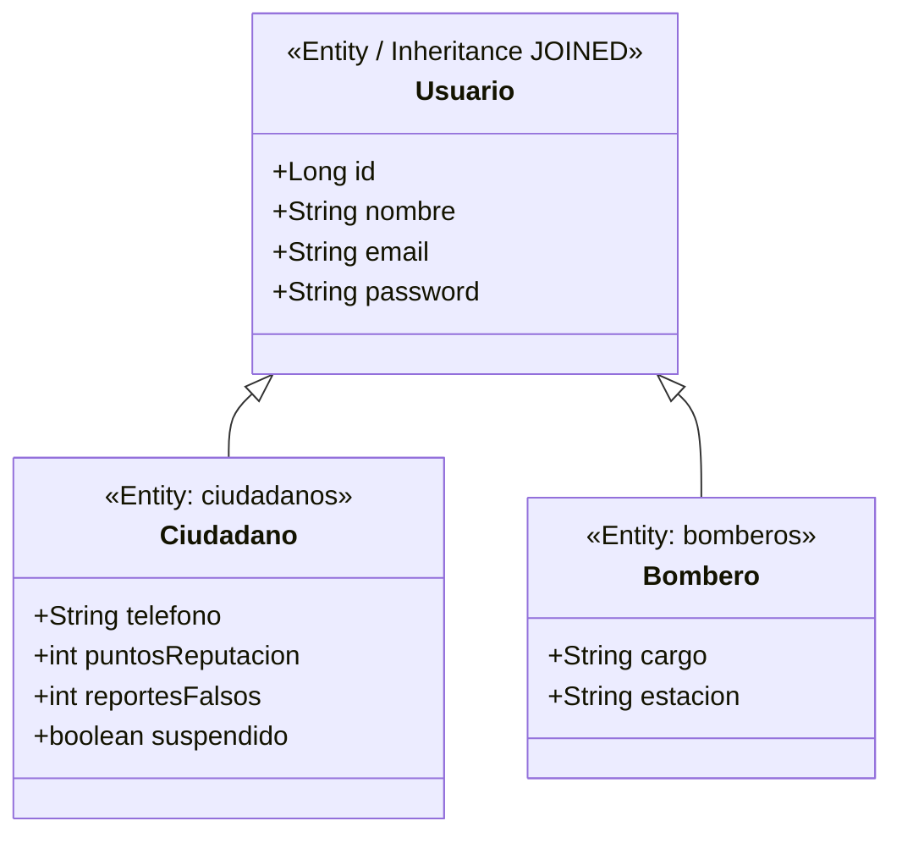

# Escuela Politécnica Nacional
## Facultad de Ingeniería de Sistemas
### Metodologías Ágiles de Desarrollo de Software (ISWD622) — Período 2026-B

---

# USER STORY MAPPING (USM) INTEGRAL Y ESTANDARIZADO
## Proyecto: AlerFire — Plataforma de Detección Temprana, Despacho Bomberil y Gobernanza Cívica

* **Grupo:** Grupo 03 (GR2SW)
* **Integrantes:** Martín Dávalos, Nayia Cóndor, Anthony Minayo, Adayely Rochina, María Fernanda Alquinga
* **Modelo de Referencia:** Matriz Bidimensional de Jeff Patton (*User Story Mapping: Discover the Whole Story, Build the Right Product*)
* **Repositorio Oficial:** [GR03_1BT3_622_26B (GitHub)](https://github.com/prem-avalox/GR03_1BT3_622_26B)

---

## 1. Estandarización Canónica de Personas (Actores del Dominio)

En correspondencia exacta (`1:1`) con el modelo de persistencia JPA/Hibernate del proyecto (`ec.edu.epn.alerfire.model`), todas las historias de usuario del sistema emplean única y exclusivamente **dos roles canónicos** que heredan de la clase base `Usuario`:

| Rol Canónico | Entidad JPA | Perfil del Actor (Persona) | Responsabilidades en el Recorrido del Usuario |
| :--- | :--- | :--- | :--- |
| **`Ciudadano`** | `Ciudadano.java` (`@Table(name="ciudadanos")`) | Persona natural que habita o transita por el Distrito Metropolitano de Quito (DMQ). | • Detecta y reporta conatos georreferenciados con evidencia fotográfica. • Consulta su perfil de confiabilidad e historial de alertas emitidas. • Visualiza notificaciones de alerta temprana, zonas seguras y rutas de evacuación. |
| **`Bombero`** | `Bombero.java` (`@Table(name="bomberos")`) | Miembro operativo del Cuerpo de Bomberos de Quito (en consola o en cuartel). | • Monitorea el mapa interactivo, capas históricas y consola cronológica. • Calcula el Tiempo Estimado de Arribo (ETA) y despacha estaciones libres. • Liquida emergencias, libera recursos y califica la veracidad (`+50` / `-100`). |

---

## 2. Estructura del Backbone (Las 5 Actividades Principales)

El eje horizontal (*Backbone*) modela el recorrido integral del usuario a través de **5 grandes actividades** y **15 pasos de usuario**:

1. **Actividad 1 — Detección y Alerta Comunitaria (`Ciudadano`)**
   * *1.1:* Fijar coordenada GPS del conato en el mapa metropolitano.
   * *1.2:* Adjuntar evidencia fotográfica del siniestro.
   * *1.3:* Consultar historial personal y estado de alertas emitidas.
2. **Actividad 2 — Monitoreo Geoespacial y Triaje (`Bombero`)**
   * *2.1:* Visualizar marcadores de focos activos en el mapa interactivo.
   * *2.2:* Monitorear y ordenar incidentes cronológicamente en el panel.
   * *2.3:* Conmutar capa histórica de conatos extintos para auditoría.
3. **Actividad 3 — Despacho Táctico y Coordinación (`Bombero`)**
   * *3.1:* Calcular el Tiempo Estimado de Arribo (ETA) por distancia geodésica.
   * *3.2:* Filtrar y deshabilitar cuarteles ocupados en el selector de despacho.
   * *3.3:* Confirmar asignación de la estación libre al conato activo.
4. **Actividad 4 — Liquidación y Gobernanza Cívica (`Bombero`)**
   * *4.1:* Registrar la extinción del fuego y liberar automáticamente el cuartel.
   * *4.2:* Calificar reporte verídico y bonificar reputación cívica (`+50` pts).
   * *4.3:* Penalizar falsa alarma (`-100` pts) y suspender infractor reincidente.
5. **Actividad 5 — Autoprotección y Alertas Comunitarias (`Ciudadano`)**
   * *5.1:* Ubicar zonas seguras y puntos de encuentro habilitados.
   * *5.2:* Trazar ruta de evacuación recomendada por menor nivel de riesgo.
   * *5.3:* Recibir alertas en bandeja comunitaria por proximidad o cambios de estado.

---

## 3. Matriz Bidimensional del User Story Mapping (Modelo Jeff Patton)

| EJE Y (Cortes de Release) \ EJE X (Backbone) | ACT 1: Detección y Alerta Comunitaria *(Actor: `Ciudadano`)* | ACT 2: Monitoreo Geoespacial y Triaje *(Actor: `Bombero`)* | ACT 3: Despacho Táctico y Coordinación *(Actor: `Bombero`)* | ACT 4: Liquidación y Gobernanza Cívica *(Actor: `Bombero`)* | ACT 5: Autoprotección y Alertas *(Actor: `Ciudadano`)* |
| :--- | :--- | :--- | :--- | :--- | :--- |
| **PASOS DEL USUARIO** *(Walking the Backbone)* | **1.1** Capturar coordenada GPS **1.2** Adjuntar evidencia foto **1.3** Consultar mi historial | **2.1** Ver mapa de focos activos **2.2** Monitorear tabla por estado **2.3** Auditar histórico extinto | **3.1** Calcular distancia y ETA **3.2** Filtrar cuartel libre **3.3** Despachar estación | **4.1** Liquidar y liberar cuartel **4.2** Bonificar reporte verídico **4.3** Sancionar falsa alarma | **5.1** Ubicar zonas seguras **5.2** Trazar ruta de evacuación **5.3** Ver bandeja de alertas |
| **🟢 RELEASE 1 (Completado — En Producción en main)** *(40 HI Estimado / 80 HR Real)* | 🟢 **`HU-I1-01`** *(7 HI)* Registro georreferenciado de conato con GPS. *Iteración 1*  🟢 **`HU-R1-02`** *(5 HI)* Carga de evidencia fotográfica del siniestro. | 🟢 **`HU-I1-02`** *(7 HI)* Visualización geoespacial en mapa interactivo. *Iteración 1*  🟢 **`HU-I1-03`** *(6 HI)* Monitoreo operativo cronológico en consola. *Iteración 1* | 🟢 **`HU-I2-01`** *(7 HI)* Despacho de estación de bomberos disponible. *Iteración 2*  🟢 **`HU-I2-03`** *(7 HI)* Cálculo dinámico de Tiempo de Arribo (ETA). *Iteración 2* | 🟢 **`HU-I2-02`** *(6 HI)* Liquidación de conato y liberación automática. *Iteración 2* | 🟢 **`HU-R1-08`** *(7 HI)* Consulta cartográfica de zonas seguras.  🟢 **`HU-R1-09`** *(7 HI)* Cálculo de ruta de evacuación por riesgo. |
| **🟡 RELEASE 2 (Próximo Incremento — Nuevas Funcionalidades)** *(40 HI Estimado / 80 HR Real)* | 🟡 **`HU-R2-03`** *(6 HI)* Consulta ciudadana de historial y confiabilidad. *Pertenece a: **Iteración 1*** | 🟡 **`HU-R2-06`** *(7 HI)* Conmutación de capa histórica de extintos. *Pertenece a: **Iteración 2*** | 🟡 **`HU-R2-05`** *(6 HI)* Filtrado reactivo de estaciones disponibles. *Pertenece a: **Iteración 2*** | 🟡 **`HU-R2-01`** *(7 HI)* Calificación de veracidad y bonificación (`+50`). *Pertenece a: **Iteración 1***  🟡 **`HU-R2-02`** *(7 HI)* Penalización por falsa alarma (`-100`) y suspensión. *Pertenece a: **Iteración 1*** | 🟡 **`HU-R2-04`** *(7 HI)* Bandeja de alertas comunitarias y cambios. *Pertenece a: **Iteración 2*** |
| **⚪ BACKLOG FUTURO (Proyectado)** *(30 HI Estimado / 60 HR Real)* | ⚪ **`HU-R3-01`** *(5 HI)* Reporte offline con sincronización PWA. | ⚪ **`HU-R3-02`** *(8 HI)* Integración con satélites térmicos (Spike). | ⚪ **`HU-R3-03`** *(8 HI)* Notificación push SMS a brigadistas en campo. | ⚪ **`HU-R3-04`** *(6 HI)* Generación de informe pericial post-siniestro PDF. | ⚪ **`HU-R3-05`** *(6 HI)* Alerta comunitaria por celda telefónica. |
