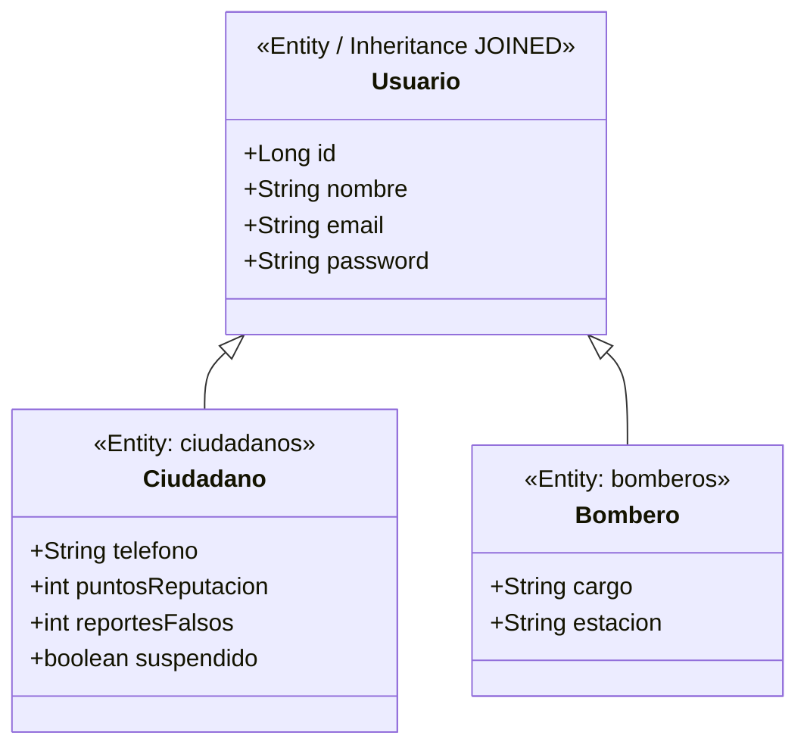
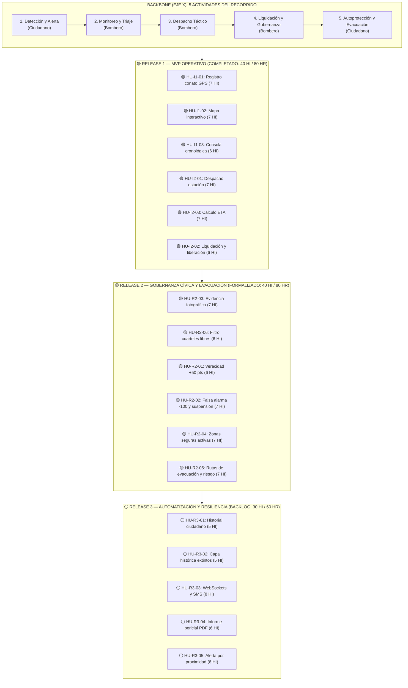

# Escuela Politécnica Nacional
## Facultad de Ingeniería de Sistemas
### Metodologías Ágiles de Desarrollo de Software (ISWD622) — Período 2026-B

---

# USER STORY MAPPING (USM) INTEGRAL Y ESTANDARIZADO
## Proyecto: AlerFire — Plataforma de Detección Temprana, Despacho Bomberil y Protección Comunitaria

* **Docente:** Prof. Julio Sandobalín, Ph.D.
* **Grupo:** Grupo 03 (GR2SW)
* **Integrantes:** Martín Dávalos, Nayia Cóndor, Anthony Minayo, Adayely Rochina, María Fernanda Alquinga
* **Modelo de Referencia:** Matriz Bidimensional de Jeff Patton (*User Story Mapping: Discover the Whole Story, Build the Right Product*)
* **Repositorio Oficial:** `GR03_1BT3_622_26B`

---

## 1. Estandarización Canónica de Personas (Actores del Dominio)

En correspondencia exacta (`1:1`) con el modelo de persistencia JPA/Hibernate del proyecto (`ec.edu.epn.alerfire.model`), todas las historias de usuario del sistema emplean única y exclusivamente **dos roles canónicos** que heredan de la clase base `Usuario`:

| Rol Canónico | Entidad JPA | Perfil del Actor (Persona) | Responsabilidades en el Recorrido del Usuario |
| :--- | :--- | :--- | :--- |
| **`Ciudadano`** | `Ciudadano.java` (`@Table(name="ciudadanos")`) | Persona natural que habita o transita por el Distrito Metropolitano de Quito (DMQ). | • Detecta y reporta conatos georreferenciados. • Adjunta evidencia fotográfica del siniestro. • Consulta el estado de sus alertas y reputación cívica. • Visualiza zonas seguras y rutas de evacuación preventiva. |
| **`Bombero`** | `Bombero.java` (`@Table(name="bomberos")`) | Miembro operativo del Cuerpo de Bomberos de Quito (en central de monitoreo o en cuartel). | • Monitorea el mapa interactivo y la consola cronológica. • Calcula el Tiempo Estimado de Arribo (ETA) por distancia. • Despacha estaciones disponibles hacia focos activos. • Liquida emergencias, libera recursos y califica la veracidad. |

> **Regla de Lenguaje Ubicuo (Ubiquitous Language):** Queda prohibido el uso de roles ambiguos o no modelados en la arquitectura (tales como *"operador"*, *"despachador"*, *"jefe"*, *"comandante"* o *"vigía"*). Toda narrativa se formula estrictamente como **`Como ciudadano,...`** o **`Como bombero,...`**.

---

## 2.Estructura del Backbone (Las 5 Actividades Principales)

El eje horizontal superior (*Backbone* o columna vertebral) modela el flujo operativo completo de extremo a extremo a través de **exactamente 5 grandes actividades** y **15 pasos del usuario (*User Steps*)**:

1. **Actividad 1 — Detección y Alerta Comunitaria (`Ciudadano`)**
   * *Paso 1.1:* Fijar coordenada GPS del conato en el mapa metropolitano.
   * *Paso 1.2:* Adjuntar evidencia fotográfica y descripción del foco.
   * *Paso 1.3:* Consultar historial personal de reportes emitidos.
2. **Actividad 2 — Monitoreo Geoespacial y Triaje (`Bombero`)**
   * *Paso 2.1:* Visualizar marcadores de focos activos en el visor cartográfico.
   * *Paso 2.2:* Monitorear y filtrar incidentes cronológicamente en el panel.
   * *Paso 2.3:* Auditar capas históricas de incendios extintos.
3. **Actividad 3 — Despacho Táctico y Coordinación (`Bombero`)**
   * *Paso 3.1:* Calcular el Tiempo Estimado de Arribo (ETA) por distancia geodésica.
   * *Paso 3.2:* Filtrar y seleccionar una estación de bomberos disponible.
   * *Paso 3.3:* Confirmar el despacho táctico y notificar a la brigada.
4. **Actividad 4 — Liquidación y Gobernanza Cívica (`Bombero`)**
   * *Paso 4.1:* Registrar la liquidación del fuego y liberar la estación asignada.
   * *Paso 4.2:* Calificar la veracidad del reporte ciudadano (`+50` pts).
   * *Paso 4.3:* Penalizar falsas alarmas (`-100` pts) y suspender reincidentes.
5. **Actividad 5 — Autoprotección y Evacuación Preventiva (`Ciudadano`)**
   * *Paso 5.1:* Consultar puntos de encuentro y zonas seguras activas.
   * *Paso 5.2:* Calcular ruta de evacuación con evaluación de nivel de riesgo.
   * *Paso 5.3:* Recibir alertas tempranas de evacuación por proximidad.

---

## 3. Convención Visual de Estados y Releases (Eje Vertical)

En cumplimiento de la metodología de Jeff Patton, las historias nunca se eliminan del mapa al completarse, sino que reflejan su estado evolutivo mediante la siguiente convención cromática:

* 🟢 **Estado VERDE (`[COMPLETADO — Release 1]`):** Historias del *Walking Skeleton* (MVP Operativo) implementadas, probadas con JUnit 4 y planificadas en el Taller XP de 20 puntos (40 HI / 80 HR).
* 🟡 **Estado AMARILLO (`[EN PROGRESO / FORMALIZADO — Release 2]`):** Historias con lógica de negocio implementada en prácticas de laboratorio previas (Práctica 2 TDD de Reputación y Tarea 3 de Evacuación/Evidencia) formalizadas en tarjetas canónicas para integración completa.
* ⚪ **Estado BLANCO (`[PLANIFICADO / BACKLOG — Release 3]`):** Historias emergentes y mejoras de deuda técnica proyectadas para iteraciones futuras (tiempo real, WebSockets, analítica pericial).

---

## 4. Matriz Bidimensional del User Story Mapping (Modelo Jeff Patton)

| EJE Y (Releases) \ EJE X (Backbone) | ACT 1: Detección y Alerta Comunitaria *(Actor: `Ciudadano`)* | ACT 2: Monitoreo Geoespacial y Triaje *(Actor: `Bombero`)* | ACT 3: Despacho Táctico y Coordinación *(Actor: `Bombero`)* | ACT 4: Liquidación y Gobernanza Cívica *(Actor: `Bombero`)* | ACT 5: Autoprotección y Evacuación *(Actor: `Ciudadano`)* |
| :--- | :--- | :--- | :--- | :--- | :--- |
| **PASOS DEL USUARIO** *(Walking the Backbone)* | **1.1** Capturar coordenada GPS **1.2** Adjuntar evidencia foto **1.3** Consultar mis alertas | **2.1** Ver mapa de focos activos **2.2** Monitorear tabla por estado **2.3** Auditar histórico extinto | **3.1** Calcular distancia y ETA **3.2** Seleccionar cuartel libre **3.3** Despachar y alertar unidad | **4.1** Liquidar y liberar cuartel **4.2** Validar reporte verídico **4.3** Sancionar falsa alarma | **5.1** Ubicar zonas seguras **5.2** Trazar ruta de evacuación **5.3** Recibir difusión celular |
| **RELEASE 1 (MVP)** 🟢 **VERDE: Completado** *(Taller XP: 2 Iteraciones, 6 HU, 40 HI / 80 HR)* | 🟢 **`HU-I1-01`** *(7 HI)* Registro georreferenciado de conato de incendio forestal. *Rol: `Ciudadano`* | 🟢 **`HU-I1-02`** *(7 HI)* Visualización geoespacial de focos activos en mapa interactivo. *Rol: `Bombero`*  🟢 **`HU-I1-03`** *(6 HI)* Monitoreo operativo y cronológico de emergencias en panel de control. *Rol: `Bombero`* | 🟢 **`HU-I2-01`** *(7 HI)* Despacho de estación de bomberos disponible a un conato activo. *Rol: `Bombero`*  🟢 **`HU-I2-03`** *(7 HI)* Estimación y cálculo de Tiempo Estimado de Arribo (ETA). *Rol: `Bombero`* | 🟢 **`HU-I2-02`** *(6 HI)* Liquidación de conato y liberación automática de recursos. *Rol: `Bombero`* | *(Sin historias en R1 para respetar el tope de velocidad de 20 HI/semana del equipo)* |
| **RELEASE 2 (Gobernanza y Evacuación)** 🟡 **AMARILLO: En Progreso / Formalizado** *(Práctica 2 Reputación + Tarea 3 Evacuación: 2 Iteraciones, 6 HU, 40 HI / 80 HR)* | 🟡 **`HU-R2-03`** *(7 HI)* Carga de evidencia fotográfica georreferenciada del conato. *Rol: `Ciudadano`* | 🟡 **`HU-R2-06`** *(6 HI)* Filtrado reactivo de estaciones disponibles en selector de despacho. *Rol: `Bombero`* | *(Cubierto por el motor Haversine y selector filtrado en R1/R2)* | 🟡 **`HU-R2-01`** *(6 HI)* Calificación de veracidad de conato y bonificación de reputación (`+50`). *Rol: `Bombero`*  🟡 **`HU-R2-02`** *(7 HI)* Penalización por falsa alarma (`-100`) y suspensión de cuenta. *Rol: `Bombero`* | 🟡 **`HU-R2-04`** *(7 HI)* Consulta cartográfica de zonas seguras y puntos de encuentro. *Rol: `Ciudadano`*  🟡 **`HU-R2-05`** *(7 HI)* Cálculo de ruta de evacuación con evaluación de nivel de riesgo. *Rol: `Ciudadano`* |
| **RELEASE 3 (Automatización y Resiliencia)** ⚪ **BLANCO: Planificado (Backlog)** *(5 HU, 30 HI / 60 HR)* | ⚪ **`HU-R3-01`** *(5 HI)* Consulta ciudadana de historial y estado de reportes propios. *Rol: `Ciudadano`* | ⚪ **`HU-R3-02`** *(5 HI)* Conmutación de capa histórica de conatos extintos en mapa. *Rol: `Bombero`* | ⚪ **`HU-R3-03`** *(8 HI)* Notificación push en tiempo real vía WebSockets y SMS a cuarteles. *Rol: `Bombero`* | ⚪ **`HU-R3-04`** *(6 HI)* Generación de reporte pericial post-siniestro en formato PDF. *Rol: `Bombero`* | ⚪ **`HU-R3-05`** *(6 HI)* Alerta comunitaria preventiva por radio de proximidad al fuego. *Rol: `Ciudadano`* |

---

## 5. Diagrama de Flujo y Cortes de Release (Visualización Arquitectónica)

---

## 6. Matriz de Trazabilidad Semestral (Unificación de Prácticas y Entregables)

Esta tabla demuestra cómo el User Story Mapping integra sin colisiones ni solapamientos todos los trabajos realizados durante el semestre:

| Código HU | Título de la Historia | Rol | Release y Estado | Entregable / Práctica de Origen | Clases Java / Vistas JSP Asociadas |
| :---: | :--- | :---: | :---: | :--- | :--- |
| **`HU-I1-01`** | Registro georreferenciado de conato de incendio forestal | `Ciudadano` | 🟢 **Release 1** (Iteración 1) | Tarea 1/3 (CU1) + Taller XP (20 pts) | `reportar-incendio.jsp`, `ReporteServlet.java`, `Incendio.java`, `Ubicacion.java`, `IncendioDAO.java` |
| **`HU-I1-02`** | Visualización geoespacial de focos activos en mapa interactivo | `Bombero` | 🟢 **Release 1** (Iteración 1) | Tarea 1/3 (CU3) + Taller XP (20 pts) | `mapa.jsp`, `MapaServlet.java`, `GestorMapa.java`, `IncendioDAO.java` |
| **`HU-I1-03`** | Monitoreo operativo y cronológico de emergencias en panel de control | `Bombero` | 🟢 **Release 1** (Iteración 1) | Tarea 1/3 (CU2) + Taller XP (20 pts) | `actualizar-estado.jsp`, `IncendioServlet.java`, `GestorIncendios.java`, `IncendioDAO.java` |
| **`HU-I2-01`** | Despacho de estación de bomberos disponible a un conato activo | `Bombero` | 🟢 **Release 1** (Iteración 2) | Práctica 3 (Incremento XP) + Taller XP | `actualizar-estado.jsp`, `IncendioServlet.java`, `GestorDespacho.java`, `EstacionBomberos.java`, `EstacionDAO.java` |
| **`HU-I2-02`** | Liquidación de conato y liberación automática de recursos | `Bombero` | 🟢 **Release 1** (Iteración 2) | Práctica 3 (Incremento XP) + Taller XP | `actualizar-estado.jsp`, `GestorDespacho.java` (`finalizarAtencion`), `IncendioDAO.java`, `EstacionDAO.java` |
| **`HU-I2-03`** | Estimación y cálculo de Tiempo Estimado de Arribo (ETA) | `Bombero` | 🟢 **Release 1** (Iteración 2) | Práctica 3 (TDD Haversine) + Taller XP | `GestorDespacho.java` (`calcularTiempoArriboMinutos`, `esRespuestaExtendida`), `GestorDespachoTest.java` |
| **`HU-R2-01`** | Calificación de veracidad de conato y bonificación de reputación (`+50`) | `Bombero` | 🟡 **Release 2** (Formalizado) | **Práctica 2 (Laboratorio TDD JUnit)** | `GestorReputacion.java`, `Ciudadano.java`, `NivelConfiabilidad.java`, `GestorReputacionTest.java` |
| **`HU-R2-02`** | Penalización por falsa alarma (`-100`) y suspensión de cuenta | `Bombero` | 🟡 **Release 2** (Formalizado) | **Práctica 2 (Laboratorio TDD JUnit)** | `GestorReputacion.java`, `Ciudadano.java` (`reportesFalsos`, `suspendido`), `GestorReputacionParametersTest.java` |
| **`HU-R2-03`** | Carga de evidencia fotográfica georreferenciada del conato | `Ciudadano` | 🟡 **Release 2** (Formalizado) | **Tarea 1 / Tarea 3 (CU1 Evidencia)** | `reportar-incendio.jsp`, `ReporteServlet.java`, `Evidencia.java`, `TipoEvidencia.java` |
| **`HU-R2-04`** | Consulta cartográfica de zonas seguras y puntos de encuentro | `Ciudadano` | 🟡 **Release 2** (Formalizado) | **Tarea 3 (CU4 Evacuación)** | `rutas-evacuacion.jsp`, `EvacuacionServlet.java`, `ZonaSegura.java`, `ZonaSeguraDAO.java` |
| **`HU-R2-05`** | Cálculo de ruta de evacuación con evaluación de nivel de riesgo | `Ciudadano` | 🟡 **Release 2** (Formalizado) | **Tarea 3 (CU4 Evacuación)** | `GestorEvacuacion.java`, `CalculadorRiesgoEvacuacion.java`, `RutaEvacuacion.java`, `RutaEvacuacionDAO.java` |
| **`HU-R2-06`** | Filtrado reactivo de estaciones disponibles en selector de despacho | `Bombero` | 🟡 **Release 2** (Formalizado) | **Deuda Técnica Identificada en R1** | `actualizar-estado.jsp`, `EstacionDAO.java`, `GestorDespacho.java` |

---

## 7. Protocolo de Gobernanza del USM para el Grupo 03

1. **Prohibición de Eliminación:** Ninguna historia de usuario completada (`🟢`) se borra del USM. Permanece en su celda para preservar el contexto completo del recorrido del usuario.
2. **Ubicación Previa Obligatoria:** Toda historia nueva debe ubicarse primero en una de las **5 actividades del Backbone** y en un **Release específico** antes de redactar su Story Card.
3. **Separación Estricta entre HU y Tareas BCE:** En el USM solo figuran funcionalidades de valor para el `Ciudadano` o el `Bombero`. Las tareas técnicas (`«boundary»`, `«control»`, `«entity»`) se documentan debajo de cada Story Card durante la planificación de la iteración.
